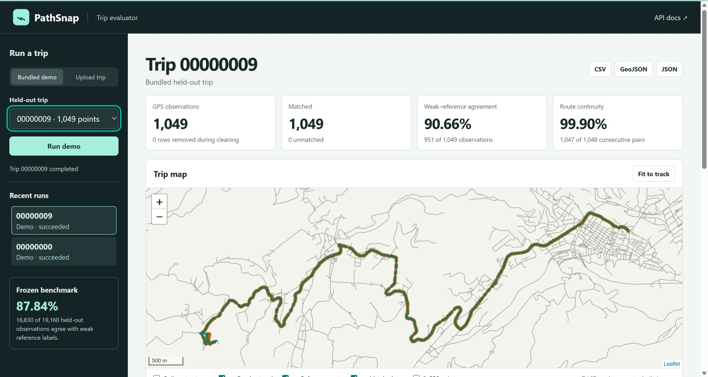
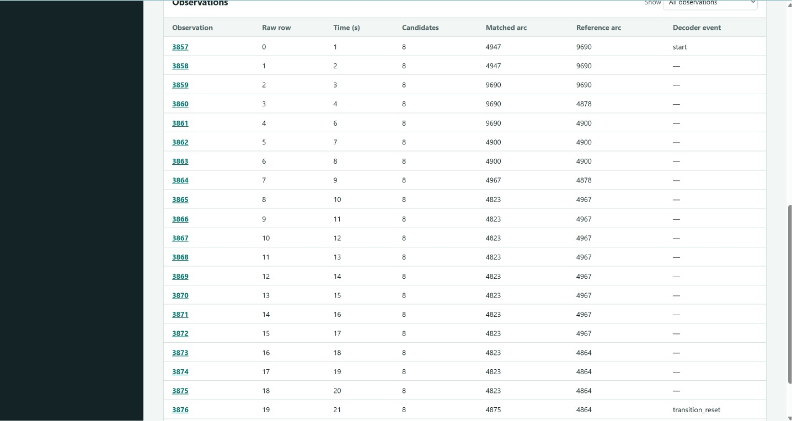

# PathSnap

PathSnap is a GPS map-matching and route-evaluation project. It processes GPS observations against a directed road network, scores candidate road segments with a frozen Selected18 XGBoost model, and reconstructs a connected route using an HMM-style Viterbi decoder.

This repository contains model experiments, preprocessing notebooks, a FastAPI inference backend, a static browser frontend, benchmark artifacts, and bundled demo trips.


## Team

| Name | Student ID |
|---|---|
| Avrit Sharma | PES2UG24CS124 |
| Aryan Mittal | PES2UG24CS089 |
| Atharva | PES2UG24CS093 |
| C.K Gagan Gowda | PES2UG24CS124 |

## Demo

The following screenshots show the trip evaluator and its observation-level results.

### Trip map and evaluation summary



### Observation-level results



## Repository Structure

```text
.
├── ExtraTrees/                         # ExtraTrees experiment and results
├── LightGBM/                           # LightGBM experiment and results
├── LogisticRegression/                 # Logistic Regression experiment and results
├── PathSnap_Core_Backend/
│   ├── backend/                        # FastAPI routes and inference services
│   ├── artifacts/                      # Frozen model, scaler, configs, provenance
│   ├── data/demo/                      # Bundled demo trips and network inputs
│   ├── docs/                            # API, input-format and deployment docs
│   ├── scripts/                         # Bundle preparation and verification
│   ├── tests/                           # Backend tests
│   ├── Dockerfile
│   ├── compose.yaml
│   └── requirements.txt
├── PathSnap_Frontend/
│   └── pathsnap_frontend/               # Static HTML, CSS and JavaScript UI
├── preprocessing/                       # Shared preprocessing notebook
├── xgboost/                              # XGBoost experiment
├── xgboost_bayesian_hmm_viterbi/         # XGBoost + HMM/Viterbi experiment
└── README.md
```

## Model and Evaluation

The deployed backend uses a frozen Selected18 XGBoost model for candidate scoring and a directed-network HMM-style Viterbi decoder for route reconstruction. Runtime model artifacts and provenance are stored under `PathSnap_Core_Backend/artifacts/`.

The committed benchmark provenance reports:

| Measure | Result |
|---|---:|
| Held-out test observations | 19,160 |
| Correct observations | 16,830 |
| Top-1 weak-reference agreement | **87.84%** |
| Test candidate coverage upper bound | 99.75% |
| Total recorded runtime | 265.73 s |

The reference labels are geometric weak-reference labels, not independently verified ground truth. The held-out test set was not used for model selection. These results describe the frozen backend benchmark, not necessarily an arbitrary uploaded trip.

## Requirements

**Backend:** Python 3.12 and pip. Docker Engine with the Docker Compose plugin is needed for container deployment.

**Frontend:** A modern browser and Python 3 to serve the static files. Internet access is required for Leaflet, OpenStreetMap tiles, and externally hosted fonts.

## Installation and Execution

### 1. Clone the repository

```bash
git clone https://github.com/DukeAvi/PathSnap-Team-3.git
cd PathSnap-Team-3
```

### 2. Start the backend locally

Open a terminal in `PathSnap_Core_Backend`.

**Windows PowerShell**

```powershell
cd PathSnap_Core_Backend
py -3.12 -m venv .venv
.\.venv\Scripts\python.exe -m pip install --upgrade pip
.\.venv\Scripts\python.exe -m pip install -r requirements.txt
.\.venv\Scripts\python.exe -m uvicorn backend.main:app --host 127.0.0.1 --port 8000
```

**Linux / macOS**

```bash
cd PathSnap_Core_Backend
python3.12 -m venv .venv
source .venv/bin/activate
python -m pip install --upgrade pip
pip install -r requirements.txt
python -m uvicorn backend.main:app --host 127.0.0.1 --port 8000
```

After startup, use:

- API documentation: [http://127.0.0.1:8000/docs](http://127.0.0.1:8000/docs)
- Health check: [http://127.0.0.1:8000/api/v1/health](http://127.0.0.1:8000/api/v1/health)
- Model metadata: [http://127.0.0.1:8000/api/v1/model](http://127.0.0.1:8000/api/v1/model)

The backend loads the frozen model and validates bundled demo assets during startup.

### 3. Run a bundled demo

In a second terminal, submit a bundled trip. The backend returns a job ID and processes the request asynchronously.

```bash
curl -X POST http://127.0.0.1:8000/api/v1/trips/demos/00000009
```

Poll the returned job ID:

```bash
curl http://127.0.0.1:8000/api/v1/jobs/<JOB_ID>
```

When the state is `succeeded`, retrieve the result:

```bash
curl http://127.0.0.1:8000/api/v1/jobs/<JOB_ID>/result
```

List bundled demo trips:

```bash
curl http://127.0.0.1:8000/api/v1/trips/demos
```

The backend also provides summary, map, and CSV, GeoJSON, and JSON export endpoints. See [Backend API documentation](PathSnap_Core_Backend/docs/API.md).

### 4. Start the frontend

In another terminal:

```bash
cd PathSnap_Frontend/pathsnap_frontend
python -m http.server 8080
```

On Windows, use `py -m http.server 8080`.

Open [http://localhost:8080](http://localhost:8080) in a browser.


## Configuration

The backend supports the following environment variables (defaults shown):

| Variable | Default | Purpose |
|---|---:|---|
| `PATHSNAP_PORT` | `8000` | Host port used by Docker Compose |
| `PATHSNAP_MAX_FILE_BYTES` | `8388608` | Maximum size per uploaded file (8 MiB) |
| `PATHSNAP_MAX_TRACK_ROWS` | `25000` | Maximum GPS track rows |
| `PATHSNAP_MAX_NODES` | `180000` | Maximum road-network nodes |
| `PATHSNAP_MAX_ARCS` | `350000` | Maximum directed road arcs |
| `PATHSNAP_MAX_ROUTE_ROWS` | `50000` | Maximum route rows |
| `PATHSNAP_MAX_SPATIAL_PAIRS` | `5000000` | Maximum spatial candidate/reference pairs |
| `PATHSNAP_MAX_ACTIVE_JOBS` | `4` | Maximum active jobs, including the running job |
| `PATHSNAP_MAX_SAVED_JOBS` | `25` | Maximum saved jobs |
| `PATHSNAP_MAX_DISPLAY_ARCS` | `10000` | Maximum backdrop arcs returned for display |

See `PathSnap_Core_Backend/.env.example` and [deployment notes](PathSnap_Core_Backend/docs/DEPLOYMENT.md).

## Tests and Artifact Verification

From `PathSnap_Core_Backend`, install development dependencies and run tests:

```bash
python -m pip install -r requirements-dev.txt
python -m pytest -q
```

Verify the frozen model and bundled artifacts:

```bash
python -m scripts.verify_bundle --per-trip
```

## Additional Documentation

- [Backend API reference](PathSnap_Core_Backend/docs/API.md)
- [Raw trip input format](PathSnap_Core_Backend/docs/INPUT_FORMAT.md)
- [Backend deployment notes](PathSnap_Core_Backend/docs/DEPLOYMENT.md)
- [Backend-specific setup](PathSnap_Core_Backend/README.md)
- [Frontend-specific notes](PathSnap_Frontend/pathsnap_frontend/README.md)
- [LightGBM results](LightGBM/%23%20PathSnap%20%E2%80%94%20LightGBM%20Results.md)
- [Logistic Regression results](LogisticRegression/README_Logistic_Regression.md)
- [ExtraTrees results](ExtraTrees/ExtraTrees/README.md)

